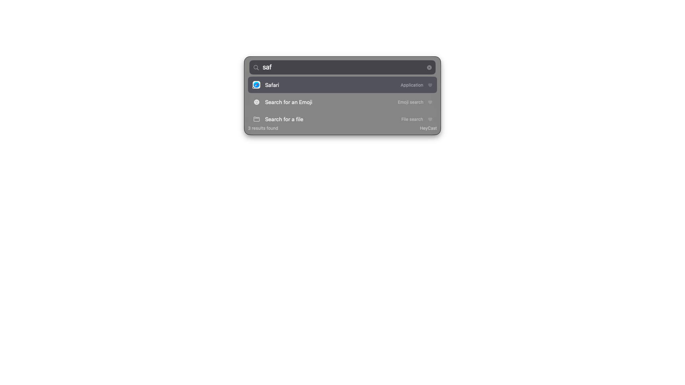

# HeyCast 👋⚡️

**Hey** — the first word that starts everything. **Cast** — call it out, invoke it.
HeyCast is a native Swift/AppKit/SwiftUI rewrite of
[RustCast](https://github.com/MystikoLab/rustcast): a blazing-fast,
Raycast-style popup launcher for macOS. It replaces the Rust/iced stack with
pure Apple frameworks so every feature leans on the platform directly.



## Features

**Search & launch**
- Fuzzy search across every installed app (LaunchServices discovery, real app icons)
- Usage ranking + ♥ favourites (pinned, persisted)
- Calculator (`12*3+2`, `sqrt(2)`, `sin(pi/2)`, `2^10` — safe recursive-descent parser)
- Unit conversion (`5 km to mi`, `100 f to c`, or `3 tbsp` for all sibling units) via Foundation `Measurement`
- Web search: end a query with `?` (or type ≥ 3 words) — configurable engine (default DuckDuckGo)
- Open URLs directly (`github.com`)
- Inline shell commands: type `> say hi`
- `quit <app>`, `quit all`, custom shell commands and modes from the config
- Right-click an app → Open, Show in Finder, Copy Path, (un)favourite, or
  **Uninstall…**: lists the app plus its leftovers (preferences, caches,
  containers, launch agents/daemons, receipts…) with sizes, all checked.
  ↵ toggles a file, ⌘↵ asks to move the checked ones to the Trash (quitting
  the app first if it's open). Root-owned files go through Finder, which asks
  for your password; everything stays recoverable with Put Back. Also
  scriptable: `heycast://uninstall?path=/Applications/Foo.app`
- Window tiling: 12 positions (halves/quarters/thirds/maximize) for the frontmost window
- Easter eggs: `randomvar`, `67`, `lemon`, `zombo`, "Ferris Plushies"

**Pages** (switch with a search or a result)
- Main search
- File search — live Spotlight results via `NSMetadataQuery`
- Clipboard history (`cbhist`) — text/URL/image, SQLite-backed, preview pane,
  optional paste-on-select. Maccy-inspired: repeat copies promote the existing
  entry to the top with a ×N count (no duplicates), and selecting an entry
  (Enter, ⌘1…⌘9, or click) promotes it the same way, ⌘P pins entries to the
  top (exempt from Clear History and the size cap), copies from password
  managers / transient sources are ignored (nspasteboard.org concealed &
  transient markers), each entry records the source app, and history is capped
  (200 by default, configurable).
- Emoji & Symbols — 8-wide grid with Pinned, Frequently Used, categories and
  Unicode symbols; Enter pastes, ⌘K for copy, skin tones, pinning and more.
  The dataset is generated by `swift scripts/gen_emoji.swift Sources/HeyCast/Resources/emoji.json`
- Notes — capture without leaving what you're doing, from the main search:
  `/todo thought` + Enter saves to the Inbox, `/word word — example sentence` saves a
  word, `/note title` creates a note and opens its editor. Each capture records
  the frontmost app, window title and browser URL. Open inbox items and
  pinned notes show up in search; the Notes page lists Pinned,
  Inbox, Words, Notes and Resolved, with ⌘↵ to resolve, ⇧⌘P to pin, ⌃X to
  delete (restorable for 30 days) and ⌘K for the rest. Stored in `notes.db`
  (SQLite, WAL, full-text search). Roadmap: [docs/notes-plan.md](docs/notes-plan.md).
- Thanh Cong TC feed (`/tc`) — quick reader for the closed community on
  `thanhcongtc.mn.co` (Mighty Networks). Typing `/tc` jumps straight into a
  dedicated reader: posts of **Thanh Cong Vu** (same default as the HTML
  digest; a toggle at the bottom includes everyone) in a compact day-grouped
  list on the left, and the selected post's actual content on the right —
  real HTML (images, quotes, lists) rendered in a themed, JavaScript-less
  web view — so you can decide whether to open it. Type to filter
  (diacritics-insensitive); reading happens in place (↵/click just selects),
  ⌘O or the safari icon opens the post on the web, ⌘C copies the link.
  🆕 marks what appeared since the last viewing session. Data access follows
  the notes in the separate `thanhcongtc` repo
  (`docs/mighty-networks-data-access.md`): the browser session cookies from
  a Netscape cookie jar (default `~/.cache/thanhcongtc.cookies.txt`), GETs
  only, results cached to `thanhcongtc-feed.json` and refreshed at most
  every 15 minutes. When the session expires (401) the feed says so with
  re-export instructions instead of failing silently.
- Assistant — fire-and-forget AI requests with an inbox. Configure agents
  (Hermes, any OpenAI-compatible API, the Anthropic API, or an MCP
  streamable-HTTP server) in Settings → Assistant, then:
  - `/alias your question` + Enter from anywhere (assistant trigger,
    configurable — "@" style also works), or ⌘↵ for the default
    agent, or type + Enter on the Assistant page
  - the panel switches to the Assistant page and the response streams
    in live; leave with Esc and the answer still arrives as a macOS
    notification, waiting in the inbox (unread dot + badge on the menu
    bar icon) until you read it
  - `heycast://ask?text=…&agent=alias` does the same from scripts
  - images: ⌘V pastes a screenshot from the clipboard (a chip under the
    search bar acknowledges it, ⌘V replaces, ✕ removes); a screenshot
    sitting on the clipboard is attached automatically. Requires a
    vision-capable model — configure an optional vision model + base
    URL per agent (z.ai's `glm-5.3-flash` accepts images on the coding
    endpoint itself; text-only endpoints need a vision model on e.g.
    `https://api.z.ai/api/paas/v4`). If the model rejects images,
    HeyCast retries text-only and says so
  - failed requests get a Retry button

  ```json
  "agents": [
    { "name": "Hermes", "alias": "hermes", "type": "mcp",
      "baseURL": "https://hermes.example.com/mcp", "apiKey": "…" },
    { "name": "GPT", "alias": "gpt", "type": "openai",
      "baseURL": "https://api.openai.com/v1", "model": "gpt-4o-mini", "apiKey": "sk-…" }
  ],
  "defaultAgent": "hermes"
  ```

  API keys live in config.json for now (Keychain storage and OAuth for
  MCP servers are planned).

**Platform-native plumbing**
- Global hotkeys via Carbon `RegisterEventHotKey` — no permissions needed
  (default toggle `⌥Space`, clipboard `⌘⇧C`)
- Borderless floating `NSPanel` with `NSVisualEffectView` vibrancy, appears on
  all Spaces, hides on focus loss, dynamic height (max 5 rows); on macOS 26+
  the panel background uses the system **Liquid Glass** material
  (`NSGlassEffectView`, interactive on macOS 27; `theme.liquidGlass` in
  config.json turns it off, custom background colors tint it)
- Aligned with Apple's macOS 27 design kit: inner surfaces (assistant
  messages, clipboard preview, chips) use standard materials, text follows
  the system type scale (Footnote 10 / Subheadline 11 / Callout 12 /
  Body 13, custom fonts still honored via `Theme.font`), and standalone
  actions (Retry, Clear) use system buttons that render as the macOS 27
  capsule style automatically
- Menu bar status item (`NSStatusItem`) with full menu
- Haptic feedback (`NSHapticFeedbackManager`), input-source restore (`TIS`),
  start-at-login (`SMAppService`), calendar events (`EventKit`)
- `heycast://` URL scheme, dark/light/system theming, custom fonts/colors,
  settings window (General / Appearance / Commands), config hot-reload (`⌘R`,
  plus live reload when config.json is edited externally)

## Build & run

Requirements: macOS 13+, Xcode (built and tested with Xcode 27.1). Command Line Tools
alone can't build it; `make_app.sh` uses the selected Xcode or the first
`/Applications/Xcode*.app` (override with `DEVELOPER_DIR`).

```sh
./scripts/make_app.sh          # swift build -c release + assemble build/HeyCast.app
open build/HeyCast.app         # LSUIElement: lives in the menu bar
```

Press `⌥Space` (or click the ⚡️ menu bar icon → Toggle View) to open the launcher.

During development `swift run` works too (the app runs unbundled as a UIElement
process); the packaged bundle is required for the icon, URL scheme and
start-at-login.

## Keyboard

| Key | Action |
| --- | --- |
| `↑` `↓` / `Ctrl+P` `Ctrl+N` | Move selection (`←`/`→` by one cell on the emoji grid) |
| `Enter` | Open focused result |
| `Esc` | Clear query → back to main page → hide |
| `⌘1`…`⌘9` | Open the n-th result directly |
| `⌘R` | Reload config & app index |
| `⌘,` | Settings |

## Configuration

`~/Library/Application Support/HeyCast/config.json` — created with defaults on
first launch, and hot-applied when edited (while HeyCast runs, external edits
reload automatically). Notable keys: `toggleHotkey` / `clipboardHotkey`
(syntax `ALT+SPACE`, `SUPER+SHIFT+C`, `CTRL+ALT+T`, … — `SUPER` = `CMD`; the
pretty symbols `⌘⌥⌃⇧` work too, F1–F12 may stand alone, an empty string
disables the hotkey; Settings records combos with a click-and-press field),
`placeholder`,
`searchURL` (`%s` is the query), `mainPage` (`blank` / `favourites` /
`frequentlyUsed` / `events`), `windowLocation`, `theme` (mode, blur, colors,
font), `shells` (`{command, alias, hotkey?}`), `modes` (`name → script`),
`aliases` (`input → expanded query`), `blacklist`, `searchDirs`. Usage ranking
lives in `ranking.json` next to it, clipboard history in `clipboard.db`, notes in `notes.db`.
Search triggers all start with `@` or `/` (Settings → General → Search
triggers, or these keys): `assistantPrefix` (default `/` — `"/alias question"`
routes to that agent), `notesInboxPrefix` / `notesWordPrefix` /
`notesNotePrefix` (default `/todo `, `/word `, `/note `; empty disables — todo/thought,
vocabulary and titled-note capture) and `tcPrefix` (default `/tc`). Typing a
partial trigger lists suggestions with the command as the row title; ↵/click
runs the command — capture and assistant triggers complete into the search
bar, the TC trigger opens its reader (a filter typed after `/tc` carries
over). The `/tc`
feed also reads `tcCookiePath`, `tcAuthor`, `tcRootSpaceID`, `tcSpaces`
(space ids fetched from the navigation menu by default list) and
`tcRefreshMinutes` (min 5).

## URL scheme

`heycast://show`, `heycast://toggle`, `heycast://quit`,
`heycast://open?target=safari`, `heycast://page?name=emoji|clipboard|files|notes|tc`,
`heycast://query?text=…` (so `heycast://query?text=%2Ftc` pops the feed open),
`heycast://settings` plus debug helpers
(`screenshot`, `capture` write window PNGs to `/tmp`).

## Project layout

See [PLAN.md](PLAN.md) for the Rust→Swift mapping table and architecture.
Sources live under `Sources/HeyCast/` (`Model/`, `Search/`, `Services/`, `UI/`),
packaging in `scripts/`.

## Deviations from RustCast

- Favourites sort **above** other results (Raycast/Alfred convention)
- Empty query shows core built-ins instead of a blank pane
- No auto-updater yet
- Window tiling prompts for Accessibility permission on first use (same as the
  original); haptic tick on failure

## License

MIT, like RustCast. This project is an independent native rewrite; RustCast's
docs and defaults were used as the feature reference.
